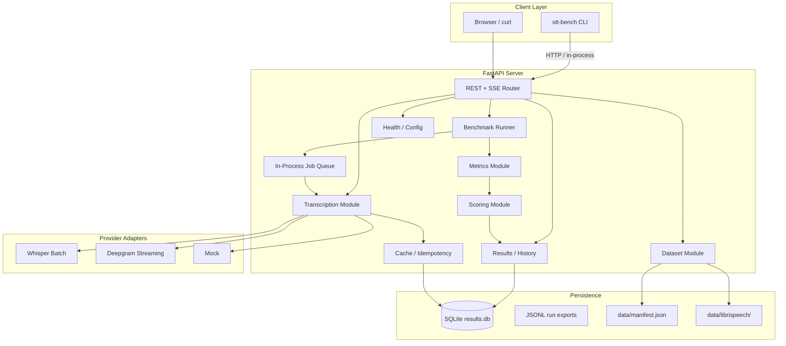
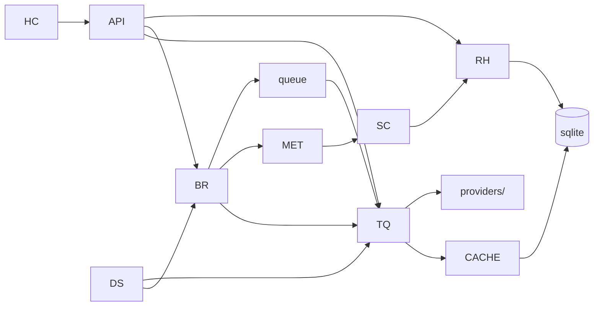

# STT Bench — Implementation Design

This document specifies a local benchmarking system for comparing speech-to-text providers on dictation-style audio. The primary comparison is **OpenAI Whisper (batch)** versus **Deepgram (streaming)**, evaluated on transcription quality, latency characteristics, cost, and a composite **vibe score** tuned for interactive dictation.

---

## A. System Overview

### Purpose

STT Bench measures how well batch and streaming STT providers perform on short utterances typical of voice dictation: clean studio speech, noisy environments, and repeatable latency/cost profiles. It supports:

- Interactive single-file transcription (REST + SSE streaming demo)
- Batch benchmark runs over a versioned local corpus with ground-truth references
- Persistent run history, caching, and leaderboard aggregation
- A CLI that can drive the API or run lightweight operations in-process

### High-Level Architecture



### Module Dependency Graph



Dependencies flow downward: **providers** have no internal dependencies; **transcription** depends on providers and cache; **benchmark runner** depends on transcription, dataset, metrics, and queue; **metrics** and **scoring** are pure computation; **results** persists everything.

---

## B. Backend Server Architecture

Location: `stt-bench/stt_bench/server/`

### Process Model

The server is a single **async FastAPI** process (`uvicorn` with `loop="asyncio"`). Concurrency is cooperative asyncio with explicit resource controls:

| Concern | Mechanism |
|---------|-----------|
| HTTP handlers | `async def` endpoints; no blocking I/O in event loop |
| Provider calls | `httpx.AsyncClient` / async SDK wrappers |
| CPU-bound metrics | `asyncio.to_thread()` for WER/chrF on large corpora |
| Batch eval parallelism | `asyncio.Semaphore(max_concurrent_samples)` (default 4) |
| Provider rate limits | Per-provider token bucket (`WhisperRateLimiter`, `DeepgramRateLimiter`) keyed by RPM from env |
| Job queue | In-process `asyncio.Queue[BenchmarkJob]` consumed by `N` worker tasks (default 1 run at a time) |

**Worker pool (v1):** One benchmark run executes sequentially per sample inside the run, with optional sample-level parallelism bounded by semaphore. Multiple runs are queued FIFO. Extension point: swap `InProcessQueue` for Redis/RQ by implementing `JobQueueBackend` protocol.

### Job Queue

```python
@dataclass
class BenchmarkJob:
    run_id: str
    dataset_id: str
    provider: str
    transport_mode: TransportMode  # "batch" | "streaming"
    config: ProviderConfig
    sample_ids: list[str] | None  # None = full corpus
    force: bool = False
```

Workers emit progress events via an internal `asyncio.Queue[ProgressEvent]` polled by `GET /api/v1/benchmark/runs/{run_id}/events` (SSE).

### Result Persistence — SQLite (chosen)

**Choice:** SQLite via `aiosqlite` for v1.

**Justification:** Benchmark runs are structured relational data (runs → sample_results → metrics) with query needs (filter by provider, date, dataset). SQLite gives indexed queries and single-file portability without a separate service. JSONL remains supported as an export/import format for sharing results, not the primary store.

Tables: `runs`, `sample_results`, `cache_entries`, `leaderboard_snapshots`.

### Cache / Idempotency

Cache key: `(provider, audio_hash, config_hash)` where:

- `audio_hash` = SHA-256 of raw audio bytes
- `config_hash` = SHA-256 of canonical JSON of `ProviderConfig` (sorted keys)

On cache hit, return stored `TranscriptionResult` without provider call. `--force` / `force: true` in API bypasses cache and overwrites entry.

TTL: none by default (deterministic STT); optional `STT_BENCH_CACHE_TTL_HOURS` for future use.

### Transport Mode

`TransportMode` is first-class on every transcribe and benchmark request:

| Mode | Providers | Behavior |
|------|-----------|----------|
| `batch` | Whisper, Mock | Upload/full file → single response |
| `streaming` | Deepgram, Mock | Chunked audio → partial transcripts → final |

Whisper adapter rejects `streaming`; Deepgram adapter rejects `batch` (v1 — document that Deepgram batch could be added later).

---

### Module 1: Providers (`stt_bench/providers/`)

**Responsibility:** Abstract STT backends; normalize provider-specific responses into `TranscriptionResult`.

#### Internal Types

```python
class TransportMode(str, Enum):
    BATCH = "batch"
    STREAMING = "streaming"

@dataclass
class ProviderCapabilities:
    supports_batch: bool
    supports_streaming: bool
    supports_confidence: bool
    supports_word_timestamps: bool

@dataclass
class StreamPartial:
    text: str
    is_final: bool
    timestamp_ms: float
    confidence: float | None = None

@dataclass
class ProviderConfig:
    provider: Literal["whisper", "deepgram", "mock"]
    model: str
    language: str = "en"
    transport_mode: TransportMode = TransportMode.BATCH
    extra: dict[str, Any] = field(default_factory=dict)
    # whisper: response_format, temperature
    # deepgram: punctuate, interim_results, endpointing_ms
    # mock: latency_ms, error_rate
```

#### REST API (provider management)

| Method | Path | Description |
|--------|------|-------------|
| `GET` | `/api/v1/providers` | List registered providers and capabilities |
| `GET` | `/api/v1/providers/{name}` | Provider detail + default config |
| `POST` | `/api/v1/providers/{name}/validate` | Validate API key and config |

**`GET /api/v1/providers` — Response 200**

```json
{
  "providers": [
    {
      "name": "whisper",
      "display_name": "OpenAI Whisper",
      "capabilities": {
        "supports_batch": true,
        "supports_streaming": false,
        "supports_confidence": false,
        "supports_word_timestamps": true
      },
      "default_config": {
        "provider": "whisper",
        "model": "whisper-1",
        "language": "en",
        "transport_mode": "batch"
      }
    }
  ]
}
```

**`POST /api/v1/providers/{name}/validate` — Request**

```json
{
  "config": { "provider": "whisper", "model": "whisper-1", "language": "en" }
}
```

**Response 200:** `{ "valid": true, "message": "API key accepted" }`

#### Error Codes

| Code | HTTP | Meaning |
|------|------|---------|
| `PROVIDER_NOT_FOUND` | 404 | Unknown provider name |
| `PROVIDER_AUTH_FAILED` | 401 | Invalid API key |
| `TRANSPORT_NOT_SUPPORTED` | 422 | Mode incompatible with provider |
| `PROVIDER_RATE_LIMITED` | 429 | Upstream or local rate limit |
| `PROVIDER_UPSTREAM_ERROR` | 502 | Provider API failure |

---

### Module 2: Transcription (`stt_bench/server/transcription/`)

**Responsibility:** Single-file transcribe; cache lookup; SSE streaming for demos.

#### Internal Types

```python
@dataclass
class TranscriptionRequest:
    audio_path: str | None
    audio_bytes: bytes | None
    provider: str
    config: ProviderConfig
    force: bool = False

@dataclass
class TranscriptionResult:
    id: str
    provider: str
    transport_mode: TransportMode
    text: str
    audio_duration_s: float
    timings: Timings
    cost_usd: float | None
    confidence: ConfidenceMetrics | None
    word_timestamps: list[WordTimestamp] | None
    cache_hit: bool
    raw_provider_response: dict | None = None
```

#### REST API

| Method | Path | Description |
|--------|------|-------------|
| `POST` | `/api/v1/transcribe` | Batch transcribe (JSON or multipart) |
| `POST` | `/api/v1/transcribe/stream` | Streaming transcribe (SSE) |
| `GET` | `/api/v1/transcribe/{id}` | Fetch cached result by ID |

**`POST /api/v1/transcribe` — Request (JSON)**

```json
{
  "audio_path": "data/librispeech/1089-134686-0000.flac",
  "provider": "whisper",
  "config": {
    "provider": "whisper",
    "model": "whisper-1",
    "language": "en",
    "transport_mode": "batch"
  },
  "force": false
}
```

Alternative: `multipart/form-data` with `file` field + `config` JSON string.

**Response 200**

```json
{
  "id": "tr_abc123",
  "provider": "whisper",
  "transport_mode": "batch",
  "text": "he hoped there would be stew for dinner",
  "audio_duration_s": 3.42,
  "timings": {
    "ttft_ms": null,
    "total_ms": 842.1,
    "rtf": 0.246
  },
  "cost_usd": 0.000513,
  "confidence": null,
  "cache_hit": false
}
```

**`POST /api/v1/transcribe/stream` — Request**

Same body as above; `transport_mode` must be `streaming`. Response is **SSE**:

```
event: partial
data: {"text": "he hoped", "is_final": false, "timestamp_ms": 120.5}

event: partial
data: {"text": "he hoped there would be stew for dinner", "is_final": true, "timestamp_ms": 890.2}

event: done
data: {"id": "tr_xyz", "timings": {"ttft_ms": 118.0, "total_ms": 890.2, "rtf": 0.26}, ...}
```

#### Error Codes

| Code | HTTP | Meaning |
|------|------|---------|
| `AUDIO_NOT_FOUND` | 404 | Path does not exist |
| `AUDIO_INVALID` | 422 | Unsupported format |
| `TRANSCRIBE_FAILED` | 500 | Internal failure after provider call |

---

### Module 3: Benchmark Runner (`stt_bench/server/benchmark/`)

**Responsibility:** Orchestrate eval over dataset; enqueue jobs; aggregate per-run metrics.

#### Internal Types

```python
@dataclass
class BenchmarkRunConfig:
    dataset_id: str
    provider: str
    transport_mode: TransportMode
    provider_config: ProviderConfig
    sample_ids: list[str] | None = None
    force: bool = False
    scoring_weights: ScoringWeights | None = None

@dataclass
class BenchmarkRun:
    id: str
    status: Literal["queued", "running", "completed", "failed"]
    config: BenchmarkRunConfig
    created_at: datetime
    completed_at: datetime | None
    sample_count: int
    aggregate_metrics: AggregateMetrics | None
    vibe_score: float | None
    error: str | None
```

#### REST API

| Method | Path | Description |
|--------|------|-------------|
| `POST` | `/api/v1/benchmark/runs` | Create and enqueue run |
| `GET` | `/api/v1/benchmark/runs` | List runs (paginated) |
| `GET` | `/api/v1/benchmark/runs/{run_id}` | Run detail + aggregates |
| `GET` | `/api/v1/benchmark/runs/{run_id}/samples` | Per-sample results |
| `GET` | `/api/v1/benchmark/runs/{run_id}/events` | SSE progress stream |
| `DELETE` | `/api/v1/benchmark/runs/{run_id}` | Cancel queued / mark aborted |

**`POST /api/v1/benchmark/runs` — Request**

```json
{
  "dataset_id": "default",
  "provider": "deepgram",
  "transport_mode": "streaming",
  "provider_config": {
    "provider": "deepgram",
    "model": "nova-2",
    "language": "en",
    "transport_mode": "streaming",
    "extra": { "punctuate": true, "interim_results": true }
  },
  "force": false
}
```

**Response 202**

```json
{
  "id": "run_20250617_001",
  "status": "queued",
  "sample_count": 30,
  "poll_url": "/api/v1/benchmark/runs/run_20250617_001"
}
```

#### Error Codes

| Code | HTTP | Meaning |
|------|------|---------|
| `DATASET_NOT_FOUND` | 404 | Unknown dataset_id |
| `RUN_NOT_FOUND` | 404 | Unknown run_id |
| `RUN_ALREADY_COMPLETE` | 409 | Cancel/delete conflict |

---

### Module 4: Metrics (`stt_bench/metrics/`)

**Responsibility:** Compute WER, latency stats, RTF, cost, optional chrF and proxy metrics from hypothesis/reference pairs.

#### Internal Types

```python
@dataclass
class SampleMetrics:
    sample_id: str
    wer: float
    wer_details: WERDetails
    chrf: float | None
    punctuation_f1: float | None
    ttft_ms: float | None
    total_ms: float
    rtf: float
    cost_usd: float | None
    confidence_mean: float | None

@dataclass
class AggregateMetrics:
    wer_mean: float
    wer_median: float
    ttft_p50_ms: float | None
    ttft_p95_ms: float | None
    total_ms_p50: float
    total_ms_p95: float
    rtf_mean: float
    cost_total_usd: float
    cost_per_minute_usd: float
    sample_count: int
```

#### REST API

| Method | Path | Description |
|--------|------|-------------|
| `POST` | `/api/v1/metrics/compute` | Compute metrics for arbitrary ref/hyp pair |
| `GET` | `/api/v1/metrics/normalize` | Debug: show normalized strings |

**`POST /api/v1/metrics/compute` — Request**

```json
{
  "reference": "he hoped there would be stew for dinner",
  "hypothesis": "he hoped there would be stew for dinner turnips and carrots and bruised potatoes",
  "timings": { "ttft_ms": 120, "total_ms": 900, "audio_duration_s": 3.5 },
  "cost_usd": 0.001
}
```

**Response 200**

```json
{
  "wer": 0.4286,
  "wer_details": { "substitutions": 0, "deletions": 0, "insertions": 3, "hits": 7 },
  "chrf": 72.4,
  "punctuation_f1": 0.85,
  "rtf": 0.257
}
```

---

### Module 5: Scoring (`stt_bench/scoring/`)

**Responsibility:** Composite **vibe score** from normalized metric components.

#### Internal Types

```python
@dataclass
class ScoringWeights:
    wer: float = 0.35
    ttft: float = 0.25
    rtf: float = 0.15
    cost: float = 0.15
    confidence: float = 0.10

@dataclass
class VibeScoreBreakdown:
    total: float  # 0-100
    components: dict[str, float]
    weights: ScoringWeights
```

#### REST API

| Method | Path | Description |
|--------|------|-------------|
| `POST` | `/api/v1/scoring/vibe` | Compute vibe score from metrics |
| `GET` | `/api/v1/scoring/weights` | Default weights |
| `PUT` | `/api/v1/scoring/weights` | Persist user weights (local config file) |

---

### Module 6: Dataset (`stt_bench/dataset/`)

**Responsibility:** Load manifest; resolve audio paths; expose ground truth.

#### Internal Types

```python
@dataclass
class SampleRecord:
    id: str
    audio_path: str
    reference_text: str
    condition: Literal["clean", "noisy"]
    source: Literal["librispeech", "synthetic"]
    metadata: dict[str, Any] = field(default_factory=dict)

@dataclass
class DatasetManifest:
    dataset_id: str
    name: str
    samples: list[SampleRecord]
```

#### REST API

| Method | Path | Description |
|--------|------|-------------|
| `GET` | `/api/v1/datasets` | List datasets |
| `GET` | `/api/v1/datasets/{id}` | Manifest summary |
| `GET` | `/api/v1/datasets/{id}/samples` | Paginated samples |
| `GET` | `/api/v1/datasets/{id}/samples/{sample_id}` | Single sample |

**`GET /api/v1/datasets/default` — Response 200**

```json
{
  "dataset_id": "default",
  "name": "LibriSpeech test-clean subset + noisy",
  "sample_count": 31,
  "conditions": { "clean": 30, "noisy": 1 }
}
```

---

### Module 7: Results / History (`stt_bench/server/results/`)

**Responsibility:** Persist and query runs; build leaderboards.

#### Internal Types

```python
@dataclass
class LeaderboardEntry:
    rank: int
    run_id: str
    provider: str
    transport_mode: TransportMode
    vibe_score: float
    wer_mean: float
    ttft_p50_ms: float | None
    cost_total_usd: float
    dataset_id: str
    created_at: datetime
```

#### REST API

| Method | Path | Description |
|--------|------|-------------|
| `GET` | `/api/v1/results/leaderboard` | Ranked entries |
| `GET` | `/api/v1/results/runs/{run_id}/export` | JSONL export |
| `POST` | `/api/v1/results/import` | Import JSONL run |

**`GET /api/v1/results/leaderboard?dataset_id=default` — Response 200**

```json
{
  "entries": [
    {
      "rank": 1,
      "run_id": "run_abc",
      "provider": "deepgram",
      "transport_mode": "streaming",
      "vibe_score": 82.4,
      "wer_mean": 0.042,
      "ttft_p50_ms": 145.0,
      "cost_total_usd": 0.012
    }
  ]
}
```

---

### Module 8: Health / Config (`stt_bench/server/health/`)

**Responsibility:** Liveness, readiness, effective configuration (redacted secrets).

#### REST API

| Method | Path | Description |
|--------|------|-------------|
| `GET` | `/api/v1/health` | Liveness |
| `GET` | `/api/v1/health/ready` | DB + provider key presence |
| `GET` | `/api/v1/config` | Redacted runtime config |

**`GET /api/v1/health/ready` — Response 200**

```json
{
  "status": "ready",
  "checks": {
    "database": "ok",
    "openai_key": "configured",
    "deepgram_key": "configured",
    "dataset": "ok"
  }
}
```

---

## C. CLI Command Tree

Entry point: `stt-bench` (Typer). Global flags: `--api-url http://127.0.0.1:8765`, `--json`, `-v`.

```
stt-bench
├── serve                          # Start FastAPI server (IN-PROCESS — no API)
│   ├── --host TEXT                # default 127.0.0.1
│   ├── --port INT                 # default 8765
│   └── --reload                   # dev auto-reload
│
├── transcribe                     # Single-file transcription (API by default)
│   ├── file PATH                  # positional audio path
│   ├── --provider [whisper|deepgram|mock]
│   ├── --mode [batch|streaming]
│   ├── --model TEXT
│   ├── --force                    # bypass cache
│   ├── --local                    # IN-PROCESS (no server)
│   └── --stream                   # print SSE partials live
│
├── benchmark                      # Run corpus eval (API by default)
│   ├── run
│   │   ├── --dataset TEXT         # default "default"
│   │   ├── --provider TEXT
│   │   ├── --mode [batch|streaming]
│   │   ├── --sample-id TEXT       # repeatable filter
│   │   ├── --force
│   │   ├── --wait                 # block until complete
│   │   └── --local                # IN-PROCESS
│   ├── status RUN_ID              # API
│   └── list                       # API
│
├── dataset
│   ├── list                       # IN-PROCESS (reads manifest)
│   ├── show DATASET_ID            # IN-PROCESS
│   ├── validate                   # IN-PROCESS — check paths + refs
│   └── stats                      # IN-PROCESS — counts, duration sum
│
├── results
│   ├── leaderboard
│   │   ├── --dataset TEXT
│   │   └── --top INT              # default 10
│   ├── show RUN_ID                # API
│   ├── export RUN_ID OUT.jsonl    # API
│   └── import IN.jsonl            # API
│
└── provider
    ├── list                       # API (or local registry fallback)
    ├── validate NAME              # API
    └── test NAME AUDIO            # API — quick smoke test
```

### Command Details

#### `stt-bench serve`

**Purpose:** Launch uvicorn with the FastAPI app.  
**Transport:** In-process only.  
**Example:** `stt-bench serve --port 8765`

#### `stt-bench transcribe file audio.flac --provider whisper --mode batch`

**Purpose:** Transcribe one file.  
**Transport:** API default; `--local` runs adapter in-process.  
**Example output:**

```
Provider: whisper (batch)
Duration: 3.42s | Latency: 842ms | RTF: 0.25 | Cost: $0.0005
────────────────────────────────────────────────────────
he hoped there would be stew for dinner turnips and carrots
```

#### `stt-bench benchmark run --provider deepgram --mode streaming --wait`

**Purpose:** Queue full dataset eval.  
**Transport:** API (`POST /api/v1/benchmark/runs`).  
**Example:** `stt-bench benchmark run --dataset default --provider deepgram --mode streaming --wait`

#### `stt-bench results leaderboard --dataset default`

**Purpose:** Print ranked runs.  
**Transport:** API.  
**Sample output:**

```
 STT Bench Leaderboard — dataset: default
┏━━━━━━┳━━━━━━━━━━┳━━━━━━━━━━━━┳━━━━━━━┳━━━━━━━━━┳━━━━━━━━━━┳━━━━━━━━┓
┃ Rank ┃ Provider ┃ Mode       ┃ Vibe  ┃ WER     ┃ TTFT p50 ┃ Cost   ┃
┡━━━━━━╇━━━━━━━━━━╇━━━━━━━━━━━━╇━━━━━━━╇━━━━━━━━━╇━━━━━━━━━━╇━━━━━━━━┩
│ 1    │ deepgram │ streaming  │ 82.4  │ 4.2%    │ 145ms    │ $0.012 │
│ 2    │ whisper  │ batch      │ 71.8  │ 3.8%    │ —        │ $0.009 │
└──────┴──────────┴────────────┴───────┴─────────┴──────────┴────────┘
```

#### `stt-bench dataset validate`

**Purpose:** Verify manifest paths and non-empty references.  
**Transport:** In-process (reads local `data/manifest.json`).

---

## D. Data Models

Pydantic models in `stt_bench/models/`.

### TranscriptionResult

```python
class Timings(BaseModel):
    ttft_ms: float | None = None
    total_ms: float
    rtf: float

class ConfidenceMetrics(BaseModel):
    mean: float | None = None
    min: float | None = None
    partial_revision_rate: float | None = None

class TranscriptionResult(BaseModel):
    id: str
    provider: str
    transport_mode: Literal["batch", "streaming"]
    text: str
    audio_duration_s: float
    timings: Timings
    cost_usd: float | None = None
    confidence: ConfidenceMetrics | None = None
    word_timestamps: list[dict] | None = None
    cache_hit: bool = False
    created_at: datetime
```

### BenchmarkRun

```python
class BenchmarkRunConfig(BaseModel):
    dataset_id: str
    provider: str
    transport_mode: Literal["batch", "streaming"]
    provider_config: ProviderConfig
    sample_ids: list[str] | None = None
    force: bool = False

class BenchmarkRun(BaseModel):
    id: str
    status: Literal["queued", "running", "completed", "failed"]
    config: BenchmarkRunConfig
    created_at: datetime
    completed_at: datetime | None = None
    sample_count: int
    aggregate_metrics: dict | None = None
    vibe_score: float | None = None
    error: str | None = None
```

### ProviderConfig

```python
class ProviderConfig(BaseModel):
    provider: Literal["whisper", "deepgram", "mock"]
    model: str
    language: str = "en"
    transport_mode: Literal["batch", "streaming"] = "batch"
    extra: dict[str, Any] = Field(default_factory=dict)
```

### SampleRecord

```python
class SampleRecord(BaseModel):
    id: str
    audio_path: str
    reference_text: str
    condition: Literal["clean", "noisy"]
    source: Literal["librispeech", "synthetic"]
    metadata: dict[str, Any] = Field(default_factory=dict)
```

### LeaderboardEntry

```python
class LeaderboardEntry(BaseModel):
    rank: int
    run_id: str
    provider: str
    transport_mode: Literal["batch", "streaming"]
    vibe_score: float
    wer_mean: float
    ttft_p50_ms: float | None = None
    cost_total_usd: float
    dataset_id: str
    created_at: datetime
```

---

## E. Metrics Definitions

### WER with Normalization

Word Error Rate uses the standard edit distance formula:

\[
\text{WER} = \frac{S + D + I}{N}
\]

where \(S\), \(D\), \(I\) are substitutions, deletions, insertions over \(N\) reference words.

**Normalization pipeline** (applied to both reference and hypothesis before WER):

1. Lowercase
2. Remove punctuation (Unicode-aware)
3. Collapse whitespace
4. Expand common contractions (`don't` → `do not`) via jiwer transforms
5. Strip filler tokens optional flag (`um`, `uh`) — off by default
6. Number normalization: spoken digits unchanged in v1

Implementation: `jiwer.Compose([ToLowerCase(), RemovePunctuation(), RemoveMultipleSpaces(), Strip()])` with optional `WhisperEnglishTextNormalizer` from `whisper.normalizers` if installed.

### Latency Metrics

| Metric | Definition | Applies to |
|--------|------------|------------|
| **TTFT** | Time from first audio byte sent to first non-empty partial transcript | streaming only |
| **Total time** | First byte sent to final transcript received | all |
| **RTF** | `total_ms / (audio_duration_s × 1000)` | all |

Aggregation across corpus: report **p50** and **p95** for TTFT and total time; **mean** for WER and RTF.

### Cost Calculation

Pricing assumptions (configurable in `config/pricing.yaml`):

| Provider | Model | Assumption |
|----------|-------|------------|
| Whisper | whisper-1 | $0.006 / minute of audio |
| Deepgram | nova-2 | $0.0043 / minute (Pay-as-you-go streaming) |
| Mock | — | $0 |

`cost_usd = (audio_duration_s / 60) × rate_per_minute`

### Composite Vibe Score

Scale: 0–100 (higher is better).

Default weights: `wer=0.35, ttft=0.25, rtf=0.15, cost=0.15, confidence=0.10`

Component normalization (all map to 0–1 where 1 is best):

- **Quality:** \(f_q = \max(0, 1 - \text{WER})\)
- **TTFT (streaming):** \(f_t = 1 / (1 + \text{TTFT\_ms} / 200)\) — 200ms scale; batch runs use \(f_t = 0.5\) neutral
- **RTF:** \(f_r = 1 / (1 + \text{RTF})\)
- **Cost:** \(f_c = 1 / (1 + \text{cost\_per\_minute} / 0.01)\)
- **Confidence:** \(f_conf = \text{mean\_confidence}\) or 0.5 if unavailable

\[
\text{vibe} = 100 \times \sum_i w_i \cdot f_i
\]

Weights are renormalized if a component is unavailable (e.g. TTFT for batch-only runs drops TTFT weight and redistributes).

### Optional Metrics

- **chrF:** `sacrebleu.metrics.CHRF` character n-gram F-score (order 6)
- **Punctuation F1:** Set F1 on punctuation characters extracted from ref/hyp
- **Partial revision rate:** `(# partial changes) / (# partial events)` for streaming
- **Re-run consistency:** WER between two transcribes of same sample with `force=true`; lower is better

---

## F. Provider Adapter Interface

```python
from abc import ABC, abstractmethod
from collections.abc import AsyncIterator
from pathlib import Path

class STTProvider(ABC):
    name: str
    capabilities: ProviderCapabilities

    @abstractmethod
    async def validate_config(self, config: ProviderConfig) -> None:
        """Raise ProviderError if config or credentials invalid."""

    @abstractmethod
    async def transcribe_batch(
        self,
        audio: bytes,
        config: ProviderConfig,
    ) -> TranscriptionResult:
        """Full-file batch transcription."""

    @abstractmethod
    async def transcribe_stream(
        self,
        audio: bytes,
        config: ProviderConfig,
    ) -> AsyncIterator[StreamPartial]:
        """Yield partial results; final partial has is_final=True."""

    async def transcribe(
        self,
        audio: bytes,
        config: ProviderConfig,
    ) -> TranscriptionResult:
        """Dispatch by config.transport_mode."""
        if config.transport_mode == TransportMode.BATCH:
            return await self.transcribe_batch(audio, config)
        parts: list[StreamPartial] = []
        async for p in self.transcribe_stream(audio, config):
            parts.append(p)
        return self._partials_to_result(parts, config)

    @abstractmethod
    def estimate_cost_usd(self, audio_duration_s: float, config: ProviderConfig) -> float:
        ...
```

**Whisper adapter:** `transcribe_batch` via OpenAI `audio.transcriptions.create`; `transcribe_stream` raises `TransportNotSupported`.

**Deepgram adapter:** `transcribe_stream` via Deepgram live SDK; simulates chunk send from file bytes; records TTFT on first interim.

**Mock adapter:** Configurable delay, fixed or WER-injecting text mutation; supports both modes for CI.

---

## G. Security

- API keys loaded from environment via `pydantic-settings`; never logged or returned by `/api/v1/config`
- `.env` gitignored; `.env.example` committed with placeholder values
- Server binds `127.0.0.1` by default (local-only)
- No authentication on API in v1 (local trust boundary); document that remote deployment requires reverse proxy + auth
- Uploaded audio stored only in temp dir, deleted after processing unless `--keep-audio` debug flag
- Provider responses in `raw_provider_response` stripped from export by default (PII safety)

---

## H. Directory Layout

```
stt-bench/
├── DESIGN.md
├── README.md
├── pyproject.toml
├── .env.example
├── .gitignore
├── data/
│   ├── README.md
│   ├── manifest.json
│   ├── librispeech/          # 30 clean FLAC clips
│   ├── noisy/                # 1 synthetic noisy clip
│   └── cache/
│       └── .gitkeep
├── config/
│   ├── pricing.yaml
│   └── scoring_weights.yaml
├── stt_bench/
│   ├── __init__.py
│   ├── cli/
│   │   ├── __init__.py
│   │   └── main.py
│   ├── models/
│   │   ├── __init__.py
│   │   ├── transcription.py
│   │   ├── benchmark.py
│   │   ├── dataset.py
│   │   └── config.py
│   ├── providers/
│   │   ├── __init__.py
│   │   ├── base.py
│   │   ├── whisper.py
│   │   ├── deepgram.py
│   │   └── mock.py
│   ├── metrics/
│   │   ├── __init__.py
│   │   ├── wer.py
│   │   ├── latency.py
│   │   └── cost.py
│   ├── scoring/
│   │   ├── __init__.py
│   │   └── vibe.py
│   ├── dataset/
│   │   ├── __init__.py
│   │   ├── loader.py
│   │   └── registry.py
│   └── server/
│       ├── __init__.py
│       ├── app.py
│       ├── deps.py
│       ├── queue.py
│       ├── cache.py
│       ├── transcription/
│       │   ├── __init__.py
│       │   └── routes.py
│       ├── benchmark/
│       │   ├── __init__.py
│       │   ├── runner.py
│       │   └── routes.py
│       ├── results/
│       │   ├── __init__.py
│       │   ├── store.py
│       │   └── routes.py
│       └── health/
│           ├── __init__.py
│           └── routes.py
└── tests/
    ├── __init__.py
    ├── test_manifest.py
    ├── test_metrics_wer.py
    └── test_mock_provider.py
```

---

## I. Dataset

### Collected Corpora

| Dataset | Path | Samples | License | Ground Truth |
|---------|------|---------|---------|--------------|
| LibriSpeech test-clean subset | `data/librispeech/` | 30 | [CC BY 4.0](https://www.openslr.org/12/) | `.trans.txt` transcripts bundled with OpenSLR archive; one utterance per FLAC |
| Synthetic noisy | `data/noisy/` | 1 | Derived from LibriSpeech | Same reference as source clip |

### Source Details

- **LibriSpeech:** OpenSLR resource 12, `test-clean` split. Subset selected from speakers 1089, 1188, 121, 1221 (diverse utterances, 3–8 seconds each).
- **Noisy clip:** `1089-134686-0000_noisy.flac` — LibriSpeech clip mixed with generated pink noise at SNR ≈ 10 dB via ffmpeg `anoisesrc` + `amix`.

### Manifest

All samples registered in `data/manifest.json`:

```json
{
  "dataset_id": "default",
  "samples": [
    {
      "id": "1089-134686-0000",
      "audio_path": "librispeech/1089-134686-0000.flac",
      "reference_text": "...",
      "condition": "clean",
      "source": "librispeech"
    }
  ]
}
```

Paths are relative to `data/`. The dataset loader resolves against `STT_BENCH_DATA_DIR` (default `./data`).

### Reproduction

See `data/README.md` for download commands and noisy clip generation steps.

---

## Appendix: Error Response Envelope

All API errors return:

```json
{
  "error": {
    "code": "DATASET_NOT_FOUND",
    "message": "Dataset 'foo' not found",
    "details": {}
  }
}
```

HTTP status matches error class (404, 422, 429, 500, etc.).
